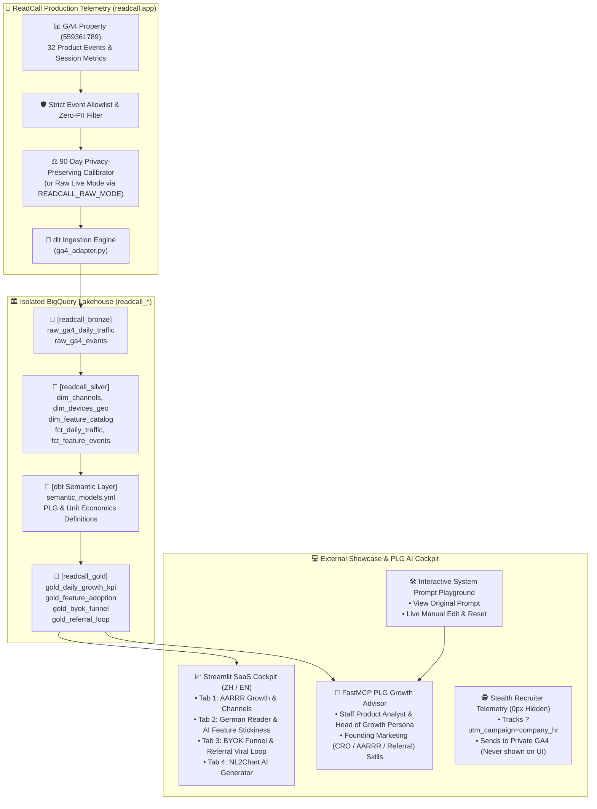

# Spec 0001: ReadCall GA4 Product Analytics, PLG Lakehouse & AI Growth Platform

**Status**: ready-for-agent  
**Category**: Production SaaS Product Analytics & PLG Data Platform  
**Target Delivery**: External Portfolio Showcase & Live Product Telemetry Analytics  
**Source Product Repository**: [`shin7965977/readcall`](https://github.com/shin7965977/readcall) (`https://readcall.app`)

---

## Problem Statement

Modern AI-native SaaS products — such as **ReadCall** (*an AI-powered German reading, morphological decomposition, 6-tense verb conjugation, and active recall platform*) — operate on non-traditional, product-led growth (PLG) models:
1. **Zero-Subscription + BYOK (Bring Your Own Key)**: Users experience free AI linguistic breakdowns (`trial_exhausted_viewed`), then connect their own free Google AI Studio Gemini API Key (`byok_key_saved`, unlocking 1,500 free daily requests while offloading 100% of AI inference server costs from the platform).
2. **Viral Referral Feature Unlocks**: Users unlock advanced features like Custom AI Tutor Prompts (`custom_prompt_saved`) by sharing referral links (`referral_modal_opened` ➔ `referral_link_copied` ➔ `referral_link_visited` ➔ `referral_unlock_success`).

Standard Google Analytics 4 (GA4) out-of-the-box reports fail to connect these multi-step PLG funnels, feature stickiness cohorts, BYOK verification friction (`byok_verify_failed`), and unit economics (offloaded AI compute savings & CAC saved via viral loops) into a unified analytical warehouse. Furthermore, when showcasing a real production product's internal analytics to external audiences (Hiring Managers, Recruiters, Technical Leads), strict security and privacy guardrails (Zero-PII, credential isolation, privacy-preserving calibrated scaling, and stealth recruiter telemetry) are mandatory.

---

## Solution

Build an isolated, production-grade, serverless ELT + Semantic Layer + PLG AI Analytics Platform in `c:\Users\shin7\Downloads\CV\readcall-analytics-platform` (and GitHub repository `shin7965977/readcall-analytics-platform`), completely decoupled from the legacy e-commerce POC (`data-pipeline-consulting-demo`):

1. **GA4 Ingestion Adapter (`ingestion/sources/ga4_adapter.py`)**:
   - Replaces `platzi_store.py`.
   - Connects to ReadCall's live GA4 property (`properties/559361789`) or reads calibrated ground-truth distributions of ReadCall's 32 telemetry events.
   - Enforces a **Strict Event Allowlist** and **Zero-PII Boundary** (only aggregated dimensions: date, channel group, device category, country, and allowlisted product events).
   - Provides **Privacy-Preserving 90-Day Calibrated Scaling** by default for external showcase (protecting early-stage raw commercial numbers while preserving exact real-world conversion ratios and weekday/weekend seasonality), with an environment toggle (`READCALL_RAW_MODE=true`) for raw internal inspection.
2. **dbt Medallion Lakehouse & Semantic Layer (`transform_dbt/`)**:
   - **Bronze (`readcall_bronze`)**: `raw_ga4_daily_traffic`, `raw_ga4_events`, `raw_ga4_funnel_steps`.
   - **Silver (`readcall_silver`)**: `dim_channels`, `dim_devices_geo`, `dim_feature_catalog` (mapping 32 events into 5 core product modules), `fct_daily_traffic`, `fct_feature_events`.
   - **Gold (`readcall_gold`)**:
     - `gold_daily_growth_kpi`: DAU, Sessions, New User Rate, Engagement Rate, Aha! Activation Rate, AI Compute Offloaded ($), Implied Referral CAC Saved ($).
     - `gold_feature_adoption`: Event volume, unique active users, penetration rate, and engagement depth across Core Reader, Dictionary, AI Tutor, Active Recall Quizzes, BYOK, and Referral modules.
     - `gold_byok_funnel`: Stage-by-stage conversion and drop-off analysis (`first_visit` ➔ `trial_banner_cta_clicked` ➔ `trial_exhausted_viewed` ➔ `byok_modal_opened` ➔ `byok_get_key_click` / `byok_manual_paste_clicked` ➔ `byok_key_saved` vs. `byok_verify_failed`).
     - `gold_referral_loop`: Viral loop conversion (`referral_modal_opened` ➔ `referral_link_copied` ➔ `referral_link_visited` ➔ `referral_unlock_success` ➔ `custom_prompt_saved`) and Viral K-Factor proxy.
   - **Semantic Layer (`transform_dbt/models/semantic_models.yml`)**: Single source of truth for PLG & Unit Economics metric formulas shared across dbt, Streamlit BI, and FastMCP.
3. **Interactive Streamlit PLG Cockpit & Editable Prompt Playground (`dashboard.py` & `dashboard_en.py`)**:
   - 4 SaaS Analytical Tabs (AARRR Growth Overview, Feature Stickiness & 80/20 Pareto, BYOK & Referral Conversion Funnels, NL2Chart AI Generator).
   - **Right-Side AI Growth Lead & Product Scientist Drawer (`fastmcp_diagnostic.py`)**:
     - Persona: Pragmatic **SaaS Head of Growth & Staff Product Data Scientist** (dropping artificial MBB buzzwords in favor of actionable PLG, CRO, UX friction reduction, and AARRR binding-constraint diagnostics powered by the *Founding Marketing* skill suite).
     - **Interactive System Prompt Editor (`🛠️ 檢視 / 修改系統 Prompt`)**: Displays the original default System Prompt on open, allowing external reviewers/users to freely edit, apply (`💾 套用自訂 Prompt`), and reset (`🔄 還原預設值`) the AI's system instructions in real time.
4. **Stealth Recruiter Telemetry (Invisible HR Open & Interaction Tracking)**:
   - Silently tracks external portfolio opens when an HR or Hiring Manager clicks a link from an email/resume (e.g., `?utm_source=resume&utm_campaign=google_hr` or `?ref=tsmc_hm`).
   - Dispatches telemetry to a **dedicated private GA4 Measurement ID (`PORTFOLIO_TRACKER_GA_ID`)** (or isolated `portfolio_*` namespace) that is **100% excluded** from the dashboard's data pipeline and UI.
   - Supports `?developer=true` local opt-out so the author's own visits are never recorded.
5. **Zero-Overlap Cloud Deployment (`terraform/` & GCP)**:
   - Deploys to isolated BigQuery datasets (`readcall_bronze`, `readcall_silver`, `readcall_gold`), Cloud Run Job (`readcall-pipeline-job`), Cloud Workflows (`readcall-pipeline-orchestrator`), and a dedicated live Streamlit Cloud Run service / Streamlit Community Cloud app without touching any `platzi_*` resources.

---

## Implementation Architecture

---

## Canonical ReadCall Event Taxonomy (32 Events across 5 Product Pillars)

| Product Module (`module_category`) | GA4 `event_name` | Business & UX Meaning in ReadCall (`readcall.app`) | Funnel Stage (AARRR) |
| :--- | :--- | :--- | :--- |
| **1. Acquisition & Onboarding** | `first_visit` | First-time visitor landing on ReadCall | Acquisition |
| | `session_start` | Session initiated | Acquisition |
| | `page_view` | Page navigation (`/`, `/library`, `/reader/[id]`, `/dictionary`) | Acquisition |
| | `user_engagement` | Engaged session (>10s or conversion) | Acquisition |
| | `scroll` | Content scrolling depth | Acquisition |
| | `click` | Outbound / navigation click | Acquisition |
| | `form_start` | Input field interaction started | Activation |
| | `starter_doc_loaded` | Pre-bundled German starter document loaded | Activation |
| | `sample_story_loaded` | Sample German story loaded for instant reading | Activation |
| | `document_uploaded` | Custom PDF / textbook image uploaded to IndexedDB | Activation |
| | `resume_reading_clicked` | Clicked Continue Reading banner (`ContinueReadingBanner.tsx`) | Retention |
| **2. Core Reader & Morphology (Aha!)** | `reader_text_selected` | Selected German word/sentence in reader for breakdown | Activation (Aha!) |
| | `reader_explain_clicked` | Triggered Gemini AI morphological & grammar explanation | Activation (Aha!) |
| | `verb_conjugation_viewed` | Viewed 6-tense / Konjunktiv verb table | Engagement |
| | `tutor_question_sent` | Sent contextual question to AI German Tutor | Engagement |
| **3. Dictionary, Vocab & Recall** | `dictionary_searched` | Queried bilingual German dictionary / Komposita splitter | Activation (Aha!) |
| | `view_search_results` | Viewed dictionary search results | Engagement |
| | `dictionary_word_selected` | Selected lemma entry to inspect gender (`der/die/das`) | Engagement |
| | `vocab_saved` | Saved German word to local IndexedDB Vocab Vault | Retention |
| | `favorite_button_clicked` | Favorited word/item (`FavoriteButton.tsx`) | Retention |
| | `quiz_started` | Started AI Active Recall Quiz (`QuizModal.tsx`) | Retention |
| | `quiz_completed` | Completed Cloze / Q&A / Komposita / Dictation quiz | Retention |
| | `flashcards_completed` | Completed spaced-repetition flashcard drill (`FlashcardsModal.tsx`) | Retention |
| **4. BYOK Monetization Funnel** | `trial_banner_cta_clicked` | Clicked free trial banner CTA to configure API key | Revenue / BYOK |
| | `trial_exhausted_viewed` | Hit free AI quota limit wall (`LinguisticInspectorContent.tsx`) | Revenue / BYOK |
| | `byok_modal_opened` | Opened `ByokModal.tsx` to configure Google Gemini API key | Revenue / BYOK |
| | `byok_get_key_click` | Clicked external link to Google AI Studio to get free key | Revenue / BYOK |
| | `byok_manual_paste_clicked` | Clicked manual paste button in `ByokModal.tsx` | Revenue / BYOK |
| | `byok_key_saved` | Verified and saved valid Gemini API key (1,500 req/day unlocked) | Revenue / BYOK |
| | `byok_verify_failed` | API key verification failed (UX friction point) | Revenue / BYOK |
| **5. Viral Referral & Feedback** | `referral_modal_opened` | Opened `TutorCustomPromptModal.tsx` referral gate | Referral |
| | `referral_link_copied` | Copied personal referral share link | Referral |
| | `referral_link_visited` | New user arrived via `?ref=` link (`ReferralWelcomeBanner.tsx`) | Referral |
| | `referral_unlock_success` | Unlocked Pro Custom AI Tutor Prompt via referral | Referral |
| | `custom_prompt_saved` | Saved custom AI Tutor system prompt | Retention |
| | `feedback_submitted` | Submitted user feedback (`FeedbackModal.tsx`) | Retention |

---

## Semantic Layer Metric Definitions (`semantic_models.yml` & `CONTEXT.md`)

1. **`aha_activation_rate` (Aha! 啟用轉換率)**:
   $$\text{Aha! Activation Rate} = \frac{\text{Unique Users triggering } (\texttt{reader\_text\_selected} \cup \texttt{dictionary\_searched})}{\texttt{first\_visit}}$$
2. **`ai_depth_ratio` (AI 形態學深度解析率)**:
   $$\text{AI Depth Ratio} = \frac{\texttt{reader\_explain\_clicked} + \texttt{verb\_conjugation\_viewed} + \texttt{tutor\_question\_sent}}{\texttt{reader\_text\_selected}}$$
3. **`byok_conversion_rate` (試用耗盡至 BYOK 綁定率)**:
   $$\text{BYOK Conversion Rate} = \frac{\texttt{byok\_key\_saved}}{\texttt{trial\_exhausted\_viewed}}$$
4. **`byok_modal_completion_rate` (BYOK 視窗完成率)**:
   $$\text{BYOK Modal Completion Rate} = \frac{\texttt{byok\_key\_saved}}{\texttt{byok\_modal\_opened}}$$
5. **`byok_verification_failure_rate` (API 金鑰驗證失敗摩擦率)**:
   $$\text{BYOK Verification Failure Rate} = \frac{\texttt{byok\_verify\_failed}}{\texttt{byok\_key\_saved} + \texttt{byok\_verify\_failed}}$$
6. **`referral_viral_k_factor` (推薦裂變係數 Proxy)**:
   $$\text{Viral K-Factor} = \left(\frac{\texttt{referral\_link\_copied}}{\texttt{referral\_modal\_opened}}\right) \times \left(\frac{\texttt{referral\_unlock\_success}}{\max(\texttt{referral\_link\_visited}, 1)}\right)$$
7. **`offloaded_ai_compute_usd` (BYOK 轉移之雲端算力節省價值)**:
   - Quantifies infrastructure cost offloaded via user-supplied Gemini keys (`Active BYOK AI Queries × $0.0025 estimated managed inference & proxy overhead`).
8. **`referral_cac_saved_usd` (自然裂變節省之獲客成本)**:
   - `referral_link_visited × $8.50 benchmark EdTech paid social CAC`.

---

## Security, Privacy & Stealth Recruiter Tracking Specification

1. **Zero-PII Ingestion Guarantee**:
   - No user emails, names, IP addresses, client IDs, or user-submitted German text/filenames ever enter `readcall_bronze`, `readcall_silver`, or `readcall_gold`.
2. **Strict Whitelist Isolation**:
   - `ga4_adapter.py` filters strictly against `ALLOWED_READCALL_EVENTS`. Any `portfolio_*` event or `utm_source=resume` traffic is dropped at ingestion time and can never appear in analytical tables.
3. **Stealth Recruiter Telemetry (`recruiter_telemetry.py` / `dashboard.py`)**:
   - Reads URL query parameters (`?ref=`, `?company=`, `?utm_source=`, `?utm_campaign=`) when an external viewer loads the Streamlit app.
   - If `?developer=true` is present, sets local opt-out and sends nothing.
   - Otherwise, silently injects a 0x0 pixel GA4 script pointing to `PORTFOLIO_TRACKER_GA_ID` (defaulting to `G-CR2LW8PH5M` or a dedicated private tracker ID) and emits:
     - `portfolio_opened` (with `recruiter_ref`, `campaign`, `app_lang`)
     - `portfolio_tab_viewed` (with `tab_name`)
     - `portfolio_ai_tested` (with `prompt_customized: true/false`)
   - Zero visual footprint on the UI: external viewers see no mention of recruiter tracking anywhere on the dashboard.

---

## Testing & Verification Gates

1. **Unit Tests (`tests/`)**:
   - Verify `GA4Adapter` yields valid canonical schemas for `raw_ga4_daily_traffic` and `raw_ga4_events`.
   - Verify strict allowlist filtering drops `portfolio_opened` and any non-product events.
   - Verify FastMCP security boundary (`sanitize_dataset_access`) strictly allows only `readcall_gold`.
2. **dbt Quality Tests (`dbt build` / `dbt test`)**:
   - Primary key uniqueness and non-null checks across all Silver and Gold models.
   - Accepted values test on `module_category` in `dim_feature_catalog`.
   - Mathematical bounds test: `byok_conversion_rate` between 0 and 1, `sessions >= engaged_sessions`.
3. **CI/CD Linting (`ruff` & `pytest`)**:
   - Zero Ruff lint errors and 100% Pytest pass rate.
