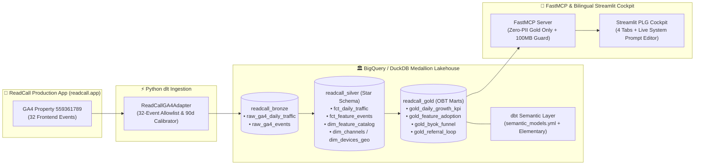

# 📘 ReadCall Product Analytics, PLG Lakehouse & AI Growth Platform

[](.github/workflows/ci_cd_pipeline.yml)
[-F59E0B)](#2-end-to-end-medallion-lakehouse-architecture)
[](transform_dbt/models/semantic_models.yml)
[](mcp_server/server.py)

**[🇹🇼 繁體中文版文件 (Traditional Chinese README)](README_zh.md)**

An end-to-end **SaaS Product Analytics, Product-Led Growth (PLG) Lakehouse, and AI Growth Advisor Platform** purpose-built for **[ReadCall (https://readcall.app)](https://readcall.app)** — an AI-powered German reading, morphological breakdown (`der`/`die`/`das` gender tokens, Komposita decomposition, 6-tense verb tables), and active recall learning application.

---

## 1. Executive Summary & Architectural Highlights

Unlike generic e-commerce toy datasets, this platform ingests and models **ReadCall's real 32 production Google Analytics 4 (GA4) telemetry events** (`properties/559361789`, Measurement ID `G-CR2LW8PH5M`), mapping every analytical metric directly back to the exact frontend React/Next.js component (`src/components/ByokModal.tsx`, `src/components/reader/LinguisticInspectorContent.tsx`, `src/components/reader/TutorCustomPromptModal.tsx`).

### Key Engineering Capabilities
1. **Fan-Out-Free Dual-Table Bronze Ingestion (`dlt` + `ga4_adapter.py`)**:
   - Physically separates session/user-scoped acquisition metrics (`raw_ga4_daily_traffic`) from event-scoped telemetry (`raw_ga4_events`) to prevent Cartesian metric inflation between session counts and custom event counts.
   - Includes a **90-Day Privacy-Preserving Calibrator** anchored on ReadCall's empirical 32-event distribution (`READCALL_RAW_MODE=true` switches to unscaled raw GA4 counts).
2. **Medallion Star Schema & dbt Semantic Layer (`dbt Core` + `MetricFlow` + `Elementary`)**:
   - **Bronze (`readcall_bronze`)**: Raw append/merge tables with schema evolution.
   - **Silver (`readcall_silver`)**: Deduplicated Star Schema (`fct_daily_traffic`, `fct_feature_events`, `dim_channels`, `dim_devices_geo`, `dim_feature_catalog`, `metricflow_time_spine`).
   - **Gold (`readcall_gold`)**: Pre-aggregated PLG Marts (`gold_daily_growth_kpi`, `gold_feature_adoption`, `gold_byok_funnel`, `gold_referral_loop`) governed by `semantic_models.yml` and 20+ automated `dbt test` contracts.
3. **Pragmatic SaaS Head of Growth & Staff Product DS AI Advisor (`FastMCP` + Gemini)**:
   - Replaces generic consulting jargon with a specialized **SaaS Head of Growth & Staff Product Data Scientist** persona grounded in **AARRR Pirate Metrics**, **Binding Constraint identification**, **CRO**, and **React component UX attribution**.
   - Enforces a strict Zero-PII security boundary (`sanitize_dataset_access("readcall_gold")`) and a `100 MB` BigQuery scan budget guard (`maximum_bytes_billed`).
4. **Interactive System Prompt Playground (`🛠️ View / Edit System Prompt`)**:
   - Users and hiring managers can click **`🛠️ 檢視 / 修改系統 Prompt (Edit System Prompt)`** inside the Streamlit AI drawer to inspect the original default System Prompt, live-edit it (`💾 Apply Custom Prompt`), and immediately observe how the AI Growth Lead's diagnostic output adapts, with a one-click reset (`🔄 Reset to Default`).
5. **Stealth Recruiter Open Telemetry (`recruiter_telemetry.py`)**:
   - Supports personalized resume/email links (`?utm_campaign=company_name` or `?ref=company_name`) that silently fire `portfolio_opened`, `portfolio_tab_viewed`, and `portfolio_ai_tested` to `PORTFOLIO_TRACKER_GA_ID` (`height=0, width=0`).
   - Strict two-way isolation ensures `portfolio_*` events are blocked at both `ga4_adapter.py` and `stg_ga4_events.sql` and never appear on the public dashboard UI. Supports `?developer=true` opt-out (`readcall_ga_opt_out`).

---

## 2. End-to-End Medallion Lakehouse Architecture



---

## 3. Why This Schema & Semantic Layer Design?

### 3.1 Physical Separation of Session Grain vs. Event Grain
In GA4 Data API (`runReport`), combining session-scoped metrics (`sessions`, `engagedSessions`, `averageSessionDuration`) with event-scoped dimensions (`eventName`) triggers **Scope Compatibility & Cardinality Fan-Out** — a single session firing 12 events (`page_view`, `reader_text_selected`, `dictionary_searched`, etc.) inflates session counts by 12x if stored in a flat table.
- **`fct_daily_traffic`**: Strictly `1 row = (event_date, channel_group, source_medium, device_category, country)`.
- **`fct_feature_events`**: Strictly `1 row = (event_date, event_name, device_category, channel_group)` joined to **`dim_feature_catalog`** (which maps each of the 32 events to its `module_category`, `aarrr_stage`, and `source_component` `.tsx` file).

### 3.2 Governed KPIs in `transform_dbt/models/semantic_models.yml`
| Metric Name | Label | Canonical Formula | Healthy / Warning Threshold | Mapped React Component |
| :--- | :--- | :--- | :--- | :--- |
| `aha_activation_rate` | Aha! Core Feature Activation Rate | `SUM(aha_users) / SUM(dau)` | Healthy `≥ 60%` / Warn `< 40%` | `src/app/reader/[id]/page.tsx`, `src/app/dictionary/page.tsx` |
| `ai_morphological_depth` | AI Morphological Depth Ratio | `SUM(ai_inference_events) / SUM(core_reader_events)` | Healthy `≥ 5%` / Warn `< 3%` | `src/components/reader/LinguisticInspectorContent.tsx` |
| `byok_conversion_rate` | Trial-to-BYOK Key Conversion Rate | `SUM(byok_key_saved) / SUM(trial_wall_hits)` | Healthy `≥ 45%` / Warn `< 30%` | `src/components/ByokModal.tsx` |
| `byok_modal_completion_rate` | ByokModal Open-to-Save Rate | `SUM(byok_key_saved) / SUM(byok_modal_opened)` | Healthy `≥ 30%` / Warn `< 20%` | `src/components/ByokModal.tsx` |
| `byok_verify_failure_rate` | API Key Verification Friction Rate | `SUM(byok_verify_failed) / SUM(byok_key_saved + byok_verify_failed)` | Healthy `≤ 8%` / Warn `> 15%` | `src/components/ByokModal.tsx` |
| `viral_k_factor` | Referral Viral K-Factor Proxy | `SUM(referral_unlock_success) / SUM(referral_modal_opened)` | Healthy `≥ 12%` / Warn `< 6%` | `src/components/reader/TutorCustomPromptModal.tsx` |

---

## 4. Quick Start (Local DuckDB & Production BigQuery)

```bash
# 1. Install dependencies
pip install -r requirements.txt

# 2. Run end-to-end ELT pipeline locally (dlt -> DuckDB -> dbt run -> dbt test)
python pipeline_runner.py --target=all --destination=duckdb --dataset=readcall_bronze --days=90

# 3. Run full test suite (pytest) and linter (ruff)
pytest -v
ruff check .

# 4. Launch Traditional Chinese or English Streamlit PLG Cockpit
streamlit run dashboard.py
# or
streamlit run dashboard_en.py
```
