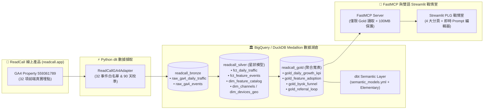

# 📘 ReadCall 產品數據分析、PLG 數據湖倉與 AI 成長顧問平台

[](.github/workflows/ci_cd_pipeline.yml)
[-F59E0B)](#2-medallion-數據湖倉架構與防膨脹設計)
[](transform_dbt/models/semantic_models.yml)
[](mcp_server/server.py)

**[🌐 English Documentation (README.md)](README.md)**

專為自有德語 AI 學習產品 **[ReadCall (https://readcall.app)](https://readcall.app)** 打造的端到端 **SaaS 產品分析（Product Analytics）、產品驅動成長（PLG）數據湖倉與 AI 成長顧問平台**。

---

## 1. 專案亮點與架構決策

本專案串接 **ReadCall 真實線上 Google Analytics 4 (GA4) 資源 (`properties/559361789` / `G-CR2LW8PH5M`)** 的 **32 項前端產品埋點事件**，並將每一項漏斗指標直接對齊至前端 React/Next.js 原始碼元件（如 `src/components/ByokModal.tsx`、`src/components/reader/LinguisticInspectorContent.tsx`、`src/components/reader/TutorCustomPromptModal.tsx`）。

### 五大核心能力
1. **防笛卡兒膨脹雙軌擷取 (`dlt` + `ga4_adapter.py`)**：
   - 在 Bronze 層將工作階段粒度 (`raw_ga4_daily_traffic`) 與事件粒度 (`raw_ga4_events`) 物理拆分，徹底避免 GA4 Data API 混查導致的指標膨脹（Fan-out Bug）。
   - 內建 **90 天隱私保護校準引擎 (Privacy-Preserving Calibrator)**，以線上 32 個事件的真實長尾分佈為基準進行趨勢擴展（亦可透過 `READCALL_RAW_MODE=true` 切換為原始未縮放計數）。
2. **Medallion 星狀模型與 dbt 語意層治理 (`dbt Core` + `MetricFlow` + `Elementary`)**：
   - **Bronze (`readcall_bronze`)**：原始增量擷取表。
   - **Silver (`readcall_silver`)**：去重星狀模型（2 張事實表 `fct_daily_traffic`、`fct_feature_events` + 3 張維度表 `dim_channels`、`dim_devices_geo`、`dim_feature_catalog` + `metricflow_time_spine`）。
   - **Gold (`readcall_gold`)**：4 張聚合業務寬表（`gold_daily_growth_kpi`、`gold_feature_adoption`、`gold_byok_funnel`、`gold_referral_loop`），由 `semantic_models.yml` 與超過 20 項 `dbt test` 自動化資料合約嚴格把關。
3. **務實型 SaaS 成長負責人與首席產品資料科學家 (`FastMCP` + Gemini)**：
   - 捨棄不切實際的傳統管顧空話，採用 **SaaS Head of Growth & Staff Product Data Scientist** 角色與 **Founding Marketing (AARRR / CRO / Viral Loop)** 框架，結論先行點出漏斗瓶頸（Binding Constraint）與對應的 `.tsx` 元件改善方案。
   - 具備嚴格的零個資防線 (`sanitize_dataset_access("readcall_gold")`) 與 BigQuery 單次查詢 `100 MB` 預算上限保護。
4. **互動式 System Prompt 實驗室 (`🛠️ 檢視 / 修改系統 Prompt`)**：
   - 使用者與面試官可在 AI 抽屜頂部點擊 **「🛠️ 檢視 / 修改系統 Prompt (Edit System Prompt)」**，展開檢視原始預設 Prompt、即時手動改寫並套用（`💾 套用自訂 Prompt`），或一鍵還原預設值（`🔄 還原預設值`）。
5. **無痕招募官開信追蹤 (`recruiter_telemetry.py`)**：
   - 當您在履歷或求職信夾帶專屬參數連結（如 `?utm_campaign=company_name` 或 `?ref=company_name`），系統會透過 `0x0px` 隱藏元件將 `portfolio_opened`、`portfolio_tab_viewed`、`portfolio_ai_tested` 傳送至您的私人 GA4。
   - 嚴格雙向隔離：`portfolio_*` 事件在擷取層與 dbt Staging 層均被強制過濾，絕不進入 `readcall_bronze/silver/gold`，亦絕不在公開儀表板顯示任何追蹤痕跡。支援 `?developer=true` 排除自身測試流量。

---

## 2. Medallion 數據湖倉架構與防膨脹設計



---

## 3. 快速啟動指南

```bash
# 1. 安裝相依套件
pip install -r requirements.txt

# 2. 執行本地端到端 ELT 管線 (dlt -> DuckDB -> dbt run -> dbt test)
python pipeline_runner.py --target=all --destination=duckdb --dataset=readcall_bronze --days=90

# 3. 執行自動化測試與程式碼品質檢查
pytest -v
ruff check .

# 4. 啟動繁體中文或英文版 Streamlit 戰情室
streamlit run dashboard.py
# 或
streamlit run dashboard_en.py
```
